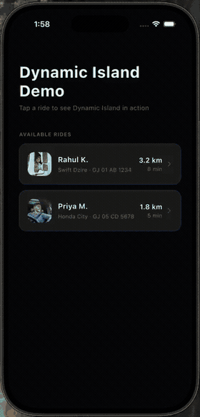

# Dynamic Island Demo

Ride tracking in a real iOS **Live Activity**, driven from Flutter over a
MethodChannel, with the driver photo passed to the widget through an App Group.

📖 Full write-up: [Dynamic Island + Flutter](https://medium.com/simform-engineering/dynamic-island-flutter-real-time-tracking-without-leaving-the-lock-screen-819698cb370f)

<p align="center">
  
</p>

## Requirements

- Flutter 3.38+ (Dart 3.10.8+) · Xcode 16+ · **iOS 16.2+** (both targets)
- **iOS only.** The app still launches on Android, but there's no Live Activity there.
- **iPhone 14 Pro or later** for the Dynamic Island. The Lock Screen banner works on any
  iOS 16.2+ device.
- **Paid** Apple Developer account. App Groups can't be registered on a free
  Personal Team, and without one the driver photo never reaches the widget.

## Run it

```bash
git clone https://github.com/ami-b-simform/dynamic_island_blog_demo.git
cd dynamic_island_blog_demo
flutter pub get
open ios/Runner.xcworkspace
```

In Xcode → Signing & Capabilities, set **the same team** on both `Runner` and
`RideTrackerWidgetExtension` (no team is committed).

Bundle IDs and App Group IDs are unique across all of Apple, and the committed
ones are already registered. To run on a device, replace `com.example` with
your own prefix (e.g. `com.yourname`) in all of these:

| What | Value to change |
|---|---|
| `Runner` bundle ID | `com.example.dynamicIslandFlutter` |
| `RideTrackerWidgetExtension` bundle ID | `com.example.dynamicIslandFlutter.RideTrackerWidget` (must stay nested under the app's) |
| App Group, both targets ([`Runner.entitlements`](ios/Runner/Runner.entitlements), [`RideTrackerWidgetExtension.entitlements`](ios/RideTrackerWidgetExtension.entitlements)) | `group.com.example.dynamicIslandFlutter` |
| [`ios/Shared/ImageHelper.swift`](ios/Shared/ImageHelper.swift) `appGroupID` | `group.com.example.dynamicIslandFlutter` |

The Simulator needs none of this: `flutter run` on an iPhone 16.2+ simulator works
as cloned.

The ride advances every 3s through `preparing → pickedup → arriving → delivered`,
then dismisses 5s after delivery.

## The App Group ID

One identifier, four places. Change it everywhere or nowhere. A mismatch is
silent: the activity still runs, the photo just never appears.

```
group.com.example.dynamicIslandFlutter
```

| Where | |
|---|---|
| `Runner` | Signing & Capabilities → App Groups |
| `RideTrackerWidgetExtension` | Signing & Capabilities → App Groups |
| [`ios/Shared/ImageHelper.swift`](ios/Shared/ImageHelper.swift) | `appGroupID` |
| [`ios/Shared/RideAttributes.swift`](ios/Shared/RideAttributes.swift) | Must belong to both targets |

## Layout

```
lib/
  home_screen.dart                    pick a ride
  tracking_screen.dart                drives the stage updates
  models/driver.dart
  channel/live_activity_channel.dart  Dart → Swift MethodChannel

ios/
  Shared/                             ← compiled into BOTH targets
    RideAttributes.swift              the app/widget data contract
    ImageHelper.swift                 App Group read + write
  Runner/
    AppDelegate.swift                 start / update / end the activity
  Runner/RideTrackerWidget/           the Live Activity UI (RideTrackerWidgetExtension target)
```

`ios/Shared/` is added to both the `Runner` and `RideTrackerWidgetExtension` targets,
so `RideAttributes` (the contract both sides agree on) exists exactly once.
Add a field and both sides see it next build. They can't drift apart.

## How it works

1. Save the driver photo to the App Group (`saveImageToAppGroup`)
2. Start the Live Activity (`startActivity`)
3. Push updates on each tick (`updateActivity`)
4. End the ride (`endActivity`) — shows the closing message for 5s, then iOS dismisses the card
